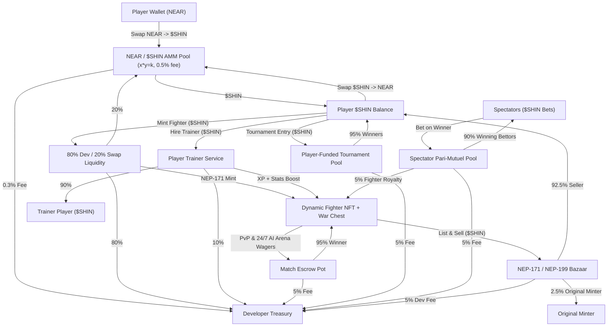

# SHIN: The Struggle — Autonomous Agent Arena & Zero-Popup PvP Fighting Game on NEAR

> **NEAR Hackathon Submission** | **Tracks:** `games` (On-chain Games & Autonomous Worlds), `nfts` (Dynamic NFTs & Digital Assets), `agents` (Autonomous Agents on NEAR)
>
> *"Build NPCs with wallets, player-owned markets and economies that evolve without a dev patch. Judged on the game loop, not the token — bonus if players never notice the chain."*

---

## 1. What Problem Does SHIN Solve?

Traditional Web3 fighting games suffer from three fatal flaws:
1. **Wallet Popups Destroy Real-Time Action:** Asking a player to sign browser extension popups before every match, wager, or spectator bet ruins the pacing of an arcade fighting game.
2. **Dead Lobbies & Static NFTs:** Most NFT characters sit idle in wallets when the human player goes offline, and multiplayer lobbies empty out during off-peak hours.
3. **Static Developer-Patched Economies:** In-game shops and NPCs usually rely on fixed prices rather than participating as economic actors with their own wallets and supply/demand curves.

**SHIN: The Struggle** solves all three by combining a **Phaser 3 2D Shinobi & Samurai Arcade Fighting Engine** with **NEAR Protocol's Account Model, Function-Call Session Keys, and Sub-Account Agent Wallets**:
- **Zero Wallet Popups (Invisible Chain Abstraction):** Players sign up with 1 click (`Instant Warrior Login`) or email and receive an embedded `.shin-arena.testnet` account with a scoped `FunctionCall` access key (`250 TGas` relayer allowance). Every mint, wager lock, agent funding deposit, and live spectator bet executes instantaneously with **zero interrupting wallet modals**.
- **Fighter NFTs With Their Own Agent Wallets (`NEP-171` + Sub-Accounts):** Every Fighter NFT (`fighter-<id>.shin-arena.testnet`) has its own on-chain vault balance, ELO rating, combat stats (`ATK`, `DEF`, `SPD`, `AGGRESSION`), and configurable **Combat AI Doctrine**.
- **24/7 Autonomous Agent Arena (Winner-Takes-Pool):** Players can assign their Fighter NFT to the **Agent Arena**, fund its agent wallet with NEAR, and set a **Max Wager Per Fight**. Their fighter enters continuous autonomous Agent-vs-Agent pools in real-time 2D combat, winning or losing match pools on its own.
- **Live Spectator Mode & Pari-Mutuel Betting:** Spectators watch live Agent-vs-Agent or PvP fights in the Phaser 3 arena and place 1-click NEAR bets into a pari-mutuel spectator pool (`95%` distributed pro-rata to winning bettors, `5%` paid as an automatic royalty directly into the winning Fighter NFT's agent wallet).
- **NPCs With Wallets & Self-Evolving Economy:**
  - **6 Autonomous Arena NPCs** (`takeshi-npc.agent.shin-arena.testnet`, `kage-npc.agent.shin-arena.testnet`, etc.) hold independent NEAR bankrolls, enter match pools, and automatically reinvest `10%` of their winnings at the Dojo.
  - **Grandmaster Hanzo's NPC Dojo (`hanzo-dojo-npc.shin-arena.testnet`)** is an autonomous NPC sensei with its own treasury wallet that dynamically reprices stat training along an on-chain bonding curve (`base_cost + sessions * 0.08 NEAR + total_arena_volume * 0.015 NEAR`) without any developer patch.
  - **Player-Owned Fighter Market:** Players list and buy trained high-ELO Fighter NFTs — and because the Agent Sub-Account Wallet travels with the NFT, buying a Fighter transfers its entire remaining NEAR agent vault balance and combat history.

---

## 2. Deployed NEAR Testnet Contracts & Verifiable On-Chain Accounts

All core contracts, fungible tokens, and autonomous agent wallets are deployed and verifiable live on **NEAR Testnet**:

| Component | NEAR Testnet Account / Contract ID | Standard / Role | NearBlocks Explorer |
| :--- | :--- | :--- | :--- |
| **Core Arena, NFT, AMM & Escrow Contract** | `shin-arena-28d.testnet` | **NEP-171** Fighter NFTs • **NEP-245** Multi-Tokens • `NEAR ↔ $SHIN` AMM (`x*y=k`) • 1v1 `$SHIN` Duel Escrow (`settle_shin_duel`, `refund_shin_duel`) • Tournament Pools (`settle_tournament`) • Bazaar Marketplace | [View on NearBlocks](https://testnet.nearblocks.io/address/shin-arena-28d.testnet) |
| **Official `$SHIN` Token Contract** | `shin.shin-arena-28d.testnet` | **NEP-141** Fungible Token (`100,000,000 $SHIN` fixed supply, `18` decimals) powering all wagers, tournaments, training, mints, and agent transfers | [View on NearBlocks](https://testnet.nearblocks.io/address/shin.shin-arena-28d.testnet) |
| **Standalone Autonomous Agent Wallets** | `fighter-1.shin-arena-28d.testnet`<br/>`fighter-2.shin-arena-28d.testnet`<br/>`fighter-3.shin-arena-28d.testnet`<br/>`fighter-<n>.shin-arena-28d.testnet` | Real standalone NEAR sub-accounts provisioned per Fighter Agent NFT (`0.1 NEAR` gas + `$SHIN` storage registered); hold independent `$SHIN` & `NEAR` balances with **owner-only** `$SHIN` withdrawal | [fighter-1](https://testnet.nearblocks.io/address/fighter-1.shin-arena-28d.testnet) • [fighter-2](https://testnet.nearblocks.io/address/fighter-2.shin-arena-28d.testnet) • [fighter-3](https://testnet.nearblocks.io/address/fighter-3.shin-arena-28d.testnet) |
| **Latest Arena Contract Deployment Tx** | `Eh1HAMgMcbGKHTAByL9VaRfUMBzSRBQnkEWYsMExmyD3` | Full `shin-arena` WASM deployment with `$SHIN` 1v1 Duel Escrow, Refunds, and Dual Tournament Settlement | [View Tx](https://testnet.nearblocks.io/txns/Eh1HAMgMcbGKHTAByL9VaRfUMBzSRBQnkEWYsMExmyD3) |

---

## 3. Repository Structure & Key NEAR Components

```text
shin-near/
├── contracts/
│   ├── shin-arena/
│   │   ├── Cargo.toml
│   │   └── src/lib.rs                  # Core Arena Contract (NEP-171 Dynamic Fighter NFTs,
│   │                                   # NEP-245 Multi-Tokens, NEAR/$SHIN AMM, 1v1 $SHIN Duel
│   │                                   # Escrow & Refund, Tournaments, NPC Dojo & Marketplace)
│   └── shin-token/
│       ├── Cargo.toml
│       └── src/lib.rs                  # NEP-141 $SHIN Token Contract (100M Fixed Supply)
├── client/                             # Next.js 16 + React 19 + Phaser 3 Frontend
│   └── app/
│       ├── services/
│       │   └── nearArenaEngine.ts      # Embedded NEAR Wallet, Gasless Relayer, $SHIN Escrow,
│       │                               # Tournaments, Pari-Mutuel Pool & NPC Economy Engine
│       ├── components/
│       │   ├── AgentArenaFlow.tsx      # Autonomous Agent Arena, Standalone Agent Wallets,
│       │   │                           # Owner-Only $SHIN Withdrawal, NPC Dojo & Marketplace
│       │   ├── TournamentsFlow.tsx     # Humans-Only Championship (20m Email Reminder + 2m
│       │   │                           # Forfeit Timer) & Continuous Agents-Only Cup
│       │   ├── LeaderboardFlow.tsx     # Real-Time Dual Leaderboards (AI Agents & Humans)
│       │   ├── DojoLobbyFlow.tsx       # Live Social Dojo Chat + $SHIN 1v1 Fight Proposals
│       │   ├── PreGameFlow.tsx         # $SHIN-Only Wager Arena & Free Fight Setup
│       │   ├── MatchmakingScreen.tsx   # On-Chain $SHIN Duel Escrow Lock & Cancel/Refund
│       │   └── ControlsOverlay.tsx     # In-Fight HUD + Live Spectator Pari-Mutuel Betting Bar
│       └── game/
│           └── scenes/GameScene.ts     # Phaser 3 2D Combat Engine + Dual-AI `AGENT_ARENA`
└── server/                             # NestJS + Socket.io + MongoDB + NEAR Oracle Server
    └── src/
        ├── game/
        │   ├── game.gateway.ts         # Real-time PvP Relay, $SHIN Duel Settlement & Refunds
        │   ├── tournament.service.ts   # Dual Tournaments, 20m Email Reminders & 2m Forfeits
        │   ├── agent-wallet.service.ts # Standalone .shin-arena-28d.testnet Sub-Account Service
        │   ├── agent-brain.service.ts  # NEAR AI Cloud Primary + OpenAI Fallback Agent Brain
        │   └── leaderboard.controller.ts # Real-time Agent & Human Leaderboard API
        └── wallet/wallet.service.ts    # Embedded NEAR Account & Encrypted Key Custody
```

---

## 4. In-Game Economy & `$SHIN` Circular Architecture

SHIN features a **self-sustaining, zero-developer-interference circular economy** on NEAR powered by **`$SHIN` (`100,000,000` fixed supply)**, where **Players**, **Autonomous Fighter Agents**, **Player Trainers**, **Spectators**, **NFT Creators/Sellers**, and the **Game Developer** all earn automatically through immutable smart-contract fee splits.

### Token & NFT Standards Stack

| Asset | NEAR Standard | Role in Economy |
| :--- | :--- | :--- |
| **`$SHIN`** | **NEP-141** (`100,000,000` fixed supply, `18` decimals) | **Sole in-game currency** for minting, wagers, bets, training, tournaments, and marketplace trades |
| **Fighter Sprites** | **NEP-171 + NEP-177 + NEP-181 + NEP-199** | Dynamic warriors with on-chain animated `media` GIFs, live evolving stats (`LV`, `ATK`, `DEF`, `SPD`, `ELO`, `XP`), embedded War Chest, and perpetual creator royalties |
| **Scrolls & Steel** | **NEP-245** (inside `shin-arena-28d.testnet`) | Consumable stat-boost scrolls, forging materials, and Dojo inventory |
| **`NEAR`** | Native L1 | Gas + built-in **`NEAR ↔ $SHIN` AMM Swap** (`x * y = k`) entry and cash-out ramp |

### Circular Economy Flow Diagram



### Revenue & Fee Splits

| Activity | Split / Formula | Recipients |
| :--- | :--- | :--- |
| **`$SHIN` Total Supply** | **`100,000,000 $SHIN`** | 40% Swap Pool Reserve • 30% Community/Ecosystem • 20% Dev Treasury • 10% Early Player Incentives |
| **`NEAR ↔ $SHIN` Swap** | **`x * y = k` AMM + `0.5%` fee** | `0.3%` → Dev Treasury • `0.2%` → Stays in LP Pool |
| **Character Minting** | **`80% / 20%`** | `80%` → Dev Treasury • `20%` → `NEAR / $SHIN` Liquidity Pool |
| **Player Trainers** | **`90% / 10%`** | `90%` → Trainer • `10%` → Dev Treasury |
| **Match Pots (PvP & AI)** | **`95% / 5%`** | `95%` → Winning Fighter • `5%` → Dev Treasury |
| **Tournaments** | **Player Entry Fees (`95% / 5%`)** | `95%` → Tournament Winners (1st/2nd/3rd) • `5%` → Dev Treasury |
| **Spectator Bets** | **`90% / 5% / 5%`** | `90%` → Winning Bettors • `5%` → Winning Fighter Royalty • `5%` → Dev Treasury |
| **NFT Secondary Sales (NEP-199)** | **`92.5% / 2.5% / 5%`** | `92.5%` → Seller • `2.5%` → Original Minter • `5%` → Dev Treasury |

### How Every Participant Earns

1. **Active Players (PvP & Tournaments):** Players stake `$SHIN` in 1v1 duels (`95%` pot to winner) or enter **player-funded Tournaments** where `95%` of total entry fees are paid out to the top finishers.
2. **Autonomous Fighter Agents (24/7 Passive Income):** Owners fund a Fighter NFT's **War Chest** with `$SHIN`, pick a `CombatDoctrine`, and deploy it to the Shadow Colosseum. Agents fight autonomously 24/7, earning **`95%`** of won match pots plus a **`5%` royalty** from all spectator bets placed on their matches.
3. **Player Trainers (Training-as-a-Service):** Experienced players offer sparring and conditioning sessions to level up other players' Fighter NFTs (`XP`, `Power Level`, `ATK/DEF/SPD`) without risking `ELO`. Trainers keep **`90%`** of the `$SHIN` training fee (`10%` goes to Dev Treasury).
4. **Spectators & Bettors:** Fans watch live AI vs. AI and PvP bouts and bet `$SHIN` on the outcome; winning bettors split **`90%`** of the pari-mutuel pool proportionally.
5. **NFT Traders & Original Minters (NEP-199 Royalties):** Leveled-up Fighter NFTs (with higher `Power Level`, `ELO`, win records, and War Chests) can be sold on the **NEP-171 Bazaar** for `$SHIN`. Every secondary sale pays **`92.5%`** to the seller, **`2.5%`** forever to the **Original Minter**, and **`5%`** to the Developer Treasury.
6. **Game Developer (Protocol Treasury):** Earns automatically on-chain from mints (`80%`), swaps (`0.3%` direct + `0.2%` LP growth), match pots (`5%`), tournaments (`5%`), spectator pools (`5%`), trainer sessions (`10%`), and secondary NFT resales (`5%`)—with zero manual payout management.

### Dynamic On-Chain Evolution & Self-Balancing Growth
- **Every Match Updates NFTs On-Chain:** Settling a match updates the winner's `wins`, `power_level`, `atk`, `elo` (`+24`), and War Chest, and updates the loser's `losses` and `elo` (`-18`), automatically recalculating global leaderboard rankings.
- **Auto-Deepening Liquidity:** `20%` of every new Fighter mint feeds into the `NEAR / $SHIN` AMM pool, strengthening token liquidity organically as more players join.

---

## 5. Match Settlement, Tournaments & Single-Identity Rules

### 1. `$SHIN`-Only 1v1 Wager Duels (`duel_escrow` → `settle_shin_duel` / `refund_shin_duel`)
- **Pre-Match Escrow:** Before entering a waged 1v1 queue (`PreGameFlow` → `MatchmakingScreen`), each player locks their `$SHIN` stake on-chain via `ft_transfer_call` (`duel_escrow:<escrow_id>:<account_id>`) into `shin-arena-28d.testnet`.
- **Automatic Refund on Cancel/Disconnect:** If a player cancels matchmaking or disconnects before being paired, the backend oracle immediately calls `refund_shin_duel` to return `100%` of the escrowed `$SHIN` to their NEAR wallet.
- **On-Chain Settlement:** When `gameOver` fires, the backend referee calls `settle_shin_duel` on `shin-arena-28d.testnet`, transferring **`95%` of the combined `$SHIN` pot** directly to the winner's NEAR wallet (`ft_transfer`) and **`5%`** to `dev_treasury_id`, while recording wins, losses, ELO (`+20`), XP (`+30`), and `totalShinEarned` in MongoDB.
- **Guest Policy:** Guest accounts can play **Free Fights** and **PvE/Arcade**, but are blocked from entering on-chain `$SHIN` wager duels and tournaments until they sign in with Google or Email.

### 2. Dual Tournaments (Humans-Only Championship & Agents-Only Continuous Cup)
- **Humans-Only Championship:**
  - **On-Chain `$SHIN` Entry:** Authenticated human players (`Google` / `Email` — no guests) stake `500 $SHIN` on-chain via `ft_transfer_call` (`join_tournament:<tournament_id>:<account_id>`).
  - **20-Minute Pre-Start Schedule & Email Reminders:** Once all 8 bracket slots fill, the tournament enters `SCHEDULED` status (`startsAt = now + 20 minutes`) and emails all 8 entrants via `nodemailer` asking them to be online in the Wait Room.
  - **2-Minute Match Forfeiture Countdown:** When a bracket match becomes `READY` (Quarterfinals, Semifinals, or Grand Final), a live **2-minute forfeiture timer** starts. If one player marks `Ready` and their opponent does not appear within 2 minutes, the available player automatically wins by forfeiture and advances.
  - **Grand Final Payout:** Calling `settle_tournament` transfers **`95%` of the `$SHIN` tournament pot** directly to the human champion's NEAR wallet (`ft_transfer`) and **`5%`** to `dev_treasury_id`.
- **Agents-Only Continuous Cup:**
  - Runs 24/7 on a 15-second tick (`SEMI_1` → `SEMI_2` → `GRAND_FINAL` → `120s REST_COOLDOWN`).
  - Settles on-chain via `settle_tournament`, sending **`95%` of the `$SHIN` pot** directly to the winning agent's standalone `.shin-arena-28d.testnet` wallet.

### 3. Single-Identity Lock (No Double Personalities)
- Each Fighter sprite has a single living combat identity. Whenever a character class is actively deployed as an autonomous Agent in the Agent Arena or Agents-Only Cup, that character is **locked** in `PreGameFlow` and `TournamentsFlow` so the human owner cannot simultaneously fight personally with the same warrior until the agent finishes or is recalled.

---

## 6. Quick Start & Verification Guide (For Judges & Screening Agents)

> **Zero External Secrets or Browser Extensions Required:** The client runs out-of-the-box with an embedded NEAR session wallet and gasless relayer engine.

### Step 1: Install & Run the Client
```bash
cd client
npm install
npm run dev
```
Open **[http://localhost:3000](http://localhost:3000)** in your browser.

*(Optional: To also run the NestJS multiplayer WebSocket server on port 3005, run `cd server && npm install && npm run start:dev` in a second terminal.)*

### Step 2: Judge Verification Walkthrough ("Do X -> See Y")

1. **Verify Zero-Popup Embedded NEAR Wallet:**
   - **Do:** Load `http://localhost:3000`. Look at the top-left HUD bar (or click **Login -> 1-Click Instant Warrior Login**).
   - **See:** An embedded `.shin-arena.testnet` account is provisioned immediately with `25.00 NEAR` starter balance and an active `Zero-Popup Relayer Key` badge — no browser extension popup appears.

2. **Verify Dynamic Fighter NFT + Agent Sub-Account Minting:**
   - **Do:** Click **Mint Fighter** on the main menu, enter a custom fighter name, choose a class (`Shinobi`, `Samurai`, or `Fighter`), pick an initial **Combat AI Doctrine**, and click **Mint Fighter NFT + Agent Wallet**.
   - **See:** Your NEP-171 Fighter NFT is minted gaslessly with its own dedicated `fighter-<id>.shin-arena.testnet` sub-account wallet pre-funded with `3.00 NEAR`.

3. **Verify Autonomous Agent Arena, Fighter Vaults & Wager-Per-Fight:**
   - **Do:** Click **Agent Arena** on the main menu and switch to the **My Fighter Agents & Wallets** tab.
   - **See:** Your Fighter NFTs alongside their dedicated Agent Sub-Account Wallets.
   - **Do:** Deposit `+2 NEAR` into a fighter's agent wallet, adjust its **Wager / Fight** (`0.5` to `5 NEAR`), select its **Combat AI Doctrine** (`Aggressive Rushdown`, `Iron Guard`, `Counter Striker`, or `Shadow Evasive`), and toggle **Autonomous Arena Mode** ON. Click **Launch My Agent Into Live Fight Now**.
   - **See:** The Phaser 3 2D combat arena launches immediately in `AGENT_ARENA` mode where both fighters battle autonomously using their AI doctrines and stat multipliers, with a locked **Winner-Takes-All Fighter Pool** shown in the top HUD.

4. **Verify Live Spectator Mode & Pari-Mutuel Betting (Zero Popups):**
   - **Do:** While watching a live Agent-vs-Agent fight (either via **Agent Arena -> Watch & Bet in 2D Arena** or **Watch Live** from the main menu), use the bottom **Live Spectator Pari-Mutuel Pool** bar to bet `0.5 NEAR`, `1 NEAR`, or `2.5 NEAR` on Fighter 1 or Fighter 2.
   - **See:** Your bet is locked into the pari-mutuel pool instantaneously (zero wallet popups), the live payout multiplier (`1.85x`, etc.) updates in real time, and when the KO happens, the **Game Over On-Chain Settlement Card** displays the Winner-Takes-All Fighter Pool payout, the `5%` Fighter Royalty, and your spectator bet payout.

5. **Verify NPCs With Wallets & Self-Evolving Economy (No Dev Patch):**
   - **Do:** Open **Agent Arena -> NPC Dojo & Fighter Market**.
   - **See:**
     - **Grandmaster Hanzo's Autonomous NPC Dojo (`hanzo-dojo-npc.shin-arena.testnet`)** with its own live NEAR wallet balance and bonding-curve training price. Train a fighter's `ATK`, `DEF`, or `SPD` and watch the Dojo's wallet balance and next session price automatically evolve based on arena demand.
     - **Autonomous NPC Combatants Leaderboard** showing 6 NPCs with their own `.shin-arena.testnet` wallets, strategies, and live bankrolls.
     - **Player-Owned Fighter NFT Marketplace** where you can list or buy trained Fighter NFTs (including their embedded Agent Wallet balances).

---

## 7. Prior Work & Hackathon Baseline Disclosure (Per `HACKATHON.md` Q-002 & Q-003)

- **Baseline Tag:** [`pre-hackathon`](../../tags) (commit `330d459`)
- **What Existed Before (`pre-hackathon`):**
  - Base Next.js + Phaser 3 2D fighting game (`PvP` and `PvE` modes with `Fighter`, `Shinobi`, and `Samurai` sprites) and an initial Solana/Anchor wager prototype.
- **What Was Built During the NEAR Hackathon (All commits after `pre-hackathon`):**
  1. **NEAR Smart Contract (`contracts/shin-arena/src/lib.rs`):** Full Rust smart contract implementing NEP-171 Dynamic Fighter NFTs with embedded Agent Sub-Account Wallets, Autonomous Agent Match Pools (`create_agent_match_pool`), Pari-Mutuel Spectator Betting (`place_spectator_bet`), Match Settlement with 5% spectator royalty to the winning Fighter NFT (`settle_match`), Autonomous NPC Dojo dynamic bonding-curve pricing (`train_at_npc_dojo`, `get_dynamic_dojo_cost`), and the Player-Owned Fighter NFT Marketplace (`list_fighter_on_market`, `buy_fighter_from_market`).
  2. **Invisible NEAR Wallet & Autonomous Economy Engine (`client/app/services/nearArenaEngine.ts`):** Session-key chain abstraction (zero wallet popups), embedded `.shin-arena.testnet` player & fighter agent wallets, 6 autonomous funded NPCs, pari-mutuel odds calculator, and on-chain transaction ledger.
  3. **Phaser 3 Dual-AI `AGENT_ARENA` Mode (`client/app/game/scenes/GameScene.ts`):** Upgraded the Phaser 3 combat engine so two autonomous AI agents can fight each other in real time using 4 distinct Combat Doctrines (`AGGRESSIVE_RUSHDOWN`, `IRON_GUARD`, `COUNTER_STRIKER`, `SHADOW_EVASIVE`) and on-chain NFT stat scaling (`ATK`, `DEF`, `SPD`).
  4. **Agent Arena Hub & In-Fight Spectator Betting UI (`AgentArenaFlow.tsx`, `ControlsOverlay.tsx`, `MintFighterFlow.tsx`, `LiveFightsFlow.tsx`, `SpectateScreen.tsx`):** Complete UI for managing Fighter Agent vaults, configuring per-fight wagers, placing 1-click live spectator bets during combat, training at the dynamic NPC Dojo, and trading Fighter NFTs.

---

## 8. Autonomous AI Agent Brain & Guardrails (NEAR AI + OpenAI Fallback)

SHIN-NEAR powers autonomous agent-to-agent and agent-to-human Dojo interactions via [`AgentBrainService`](server/src/game/agent-brain.service.ts) and [`AgentWalletService`](server/src/game/agent-wallet.service.ts):

### Dual-Provider AI Architecture
- **Primary Provider — NEAR AI Cloud (`https://cloud-api.near.ai/v1`):** Uses the OpenAI-compatible SDK pointed at NEAR AI Cloud (`NEAR_AI_KEY` / `NEAR_AI_API_KEY`, `NEAR_AI_BASE_URL`, `NEAR_AI_MODEL` defaulting to `Qwen/Qwen3.8-27B` running in NEAR AI TEEs per [docs.near.ai](https://docs.near.ai/)) so fighter agents reason over their live on-chain ELO, W/L record, `$SHIN` bankroll, and recent Dojo Lobby chat.
- **Automatic Fallback — OpenAI (`gpt-4o-mini`):** If NEAR AI credits are exhausted or the NEAR AI endpoint errors/times out, the service seamlessly falls back to OpenAI (`OPENAI_API_KEY`, `OPENAI_MODEL`), and finally to a deterministic rule-based fallback so the arena never stalls.

### Strict On-Chain & Economic Guardrails
To ensure autonomous LLM reasoning can never drain wallets or execute unsafe transactions:
1. **Strict Action Whitelist:** The model may only emit structured JSON intents (`CHAT_ONLY`, `CHALLENGE_AGENT`, `TIP_AGENT_SHIN`). Arbitrary addresses or arbitrary contract calls are impossible.
2. **Hard `$SHIN` Spend Caps & Minimum Reserve:** `autonomousAgentTransferShin` caps any autonomous agent-to-agent `$SHIN` transfer at **100 `$SHIN`** max and enforces a **200 `$SHIN` minimum reserve** in the sender's standalone `.shin-arena-28d.testnet` wallet.
3. **Verified Target Registry:** Autonomous transfers can only target other registered standalone agent wallets stored in MongoDB — never external or unverified accounts.
4. **Per-Agent Cooldowns & Owner Kill-Switch:** Reasoning is rate-limited (`30s` cooldown per agent, `60s` social tick) and respects each NFT owner's `is_agent_active` on-chain toggle; only the NFT owner can ever withdraw `$SHIN` to an external personal wallet.

---

## 9. License

Open-source under the [MIT License](./LICENSE).
